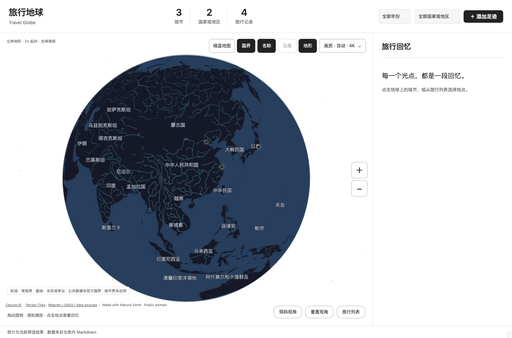

# Travel Globe · 旅行地球

在 Obsidian 里用三维地球浏览旅行足迹、Markdown 回忆与照片。数据保存在自己的仓库中，无需注册账户。

- 自然色地球与暗蓝底图切换，国界、国家名称和主要水系。
- 地球到城市连续缩放、真实地形与离线资源缓存。
- 地点、单日或多日日期、可选时段、照片和完整回忆；跨年筛选。
- 失败后恢复本次运行中的草稿，已导入照片不会重复导入。
- 桌面与手机布局，跟随 Obsidian 深浅色。



## 安装

从仓库的 **Releases** 下载完整 `travel-globe-0.9.1.zip`，按[安装说明](安装说明.md)操作。必须保留整个 `runtime-assets/`，只复制三个插件文件不能完整运行。

本版本为 **0.9.1 预发行候选**。最低声明版本为 Obsidian 1.5.0；实际桌面验收环境为 Obsidian 1.13.7／1.14.5。桌面上的手机尺寸和触摸模拟已验证，实体 iOS／Android、系统键盘与相册、真实跨设备同步及长期耗电仍待验收。

全球精确城市行政边界和按旅行记录自动点亮市域尚未实现。国界来自 Natural Earth，争议或未定线使用虚线，属于地理示意。

## 隐私、网络与许可

笔记与照片保存在本地 Markdown 仓库。画质、主题与地图偏好按设备保存；插件不配置同步服务，不上传旅行笔记或照片。

首次浏览未缓存的精细影像／高程需要联网；可在设置中分别关闭底图更新和卫星影像。离线只覆盖随包提供和已缓存的资源，不能保证未访问区域的细节。[数据与网络说明](docs/数据与网络.md)。

代码采用 [MIT](LICENSE)。Cesium、NASA、Natural Earth、GeoNames、地形数据和影像另有各自许可与署名。EOX Sentinel-2 影像采用 **CC BY-NC-SA 4.0，仅非商业使用**；代码 MIT 不替代这些限制。[第三方说明](THIRD_PARTY_NOTICES.md)。

## 开发与验证

Node.js 22+：

```sh
npm ci
npm run build
npm test
npm run package
```

发布输出在 `dist/`，包含完整安装包、干净源码包、虚构示例与 SHA-256。`npm test`包含 TypeScript 与 JavaScript 测试；Mac安装故障测试需要 `/bin/zsh`。

[开发说明](docs/开发说明.md) · [0.9.1 验收范围](docs/0.9.1验收.md)

## English

A local-first Obsidian travel journal with an offline 3D globe, Markdown memories, photos, optional date ranges and time-of-day labels. Natural and atlas maps share the same scene. No account is required. Download the **complete ZIP** from Releases; `runtime-assets/` is required.

This is a prerelease. Physical mobile devices, real cross-device synchronization and long-term power use remain unverified. Precise worldwide city polygons and automatic city-area highlighting are not implemented. See the third-party notices before using external imagery, especially EOX's non-commercial license.
